# Style Gallery

Contoh visual untuk semua style di `style/`. Satu gambar per style: `sample.png` (dari style itu sendiri), fallback `poster.jpg`. Klik gambar untuk buka ukuran penuh.

Semua style di sini **plan-only**: masing-masing membawa aturan look, motion & sound plus token warna/font, dipakai untuk strategy, hook, script, storyboard dan style prompt. Tidak ada yang menulis kode scene atau render.

Total **109** style · semua plan-ready.

**Atribusi gambar:** 99 `poster.jpg` berasal dari [Lemo-Opuscar by Lemomo (LemoLab)](https://github.com/lemomo-ai/lemo-opuscar), CC BY-NC 4.0. `bang-motion` poster diturunkan dari `sample.png` milik library ini. 9 style local-only lain (`papercut`, `crosshatch`, `cut-paper`, `isometric`, `line-art-animation`, `math`, `pixel`, `riso`, `sketchbook`) memakai sample library ini, dan `papercut` masih placeholder yang perlu diganti render nyata.

## Daftar isi

- [3D & Miniature](#3d--miniature)
- [Cartoons](#cartoons)
- [Data & Maps](#data--maps)
- [Edit & Documentary](#edit--documentary)
- [Film & Tape](#film--tape)
- [Games](#games)
- [Graphic & Type](#graphic--type)
- [Instruments & Evidence](#instruments--evidence)
- [Light & Lines](#light--lines)
- [Line Diagrams](#line-diagrams)
- [Other](#other)
- [Painting & Illustration](#painting--illustration)
- [Print & Printmaking](#print--printmaking)
- [Screens & Interfaces](#screens--interfaces)
- [Sketch & Board](#sketch--board)
- [Traditional Crafts](#traditional-crafts)

## 3D & Miniature

| Style | Contoh | Keterangan | Status |
|---|---|---|---|
| [Brick Toy](style/brick-toy/SKILL.md)<br>`brick-toy` | <a href="style/brick-toy/sample.png">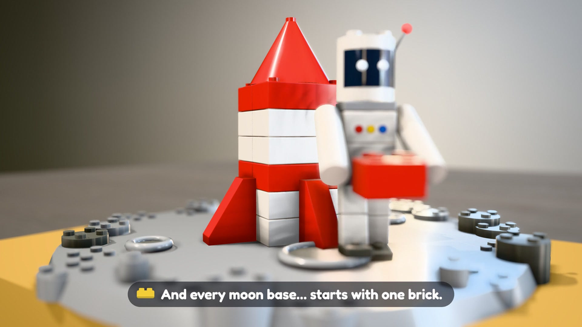</a> | Stop-motion toy-brick films shot like macro photography on a real desk: a world built from interlocking plastic bricks with round studs, animated a… | plan-ready |
| [Crayon World 3D](style/crayon-world/SKILL.md)<br>`crayon-world` | <a href="style/crayon-world/sample.png">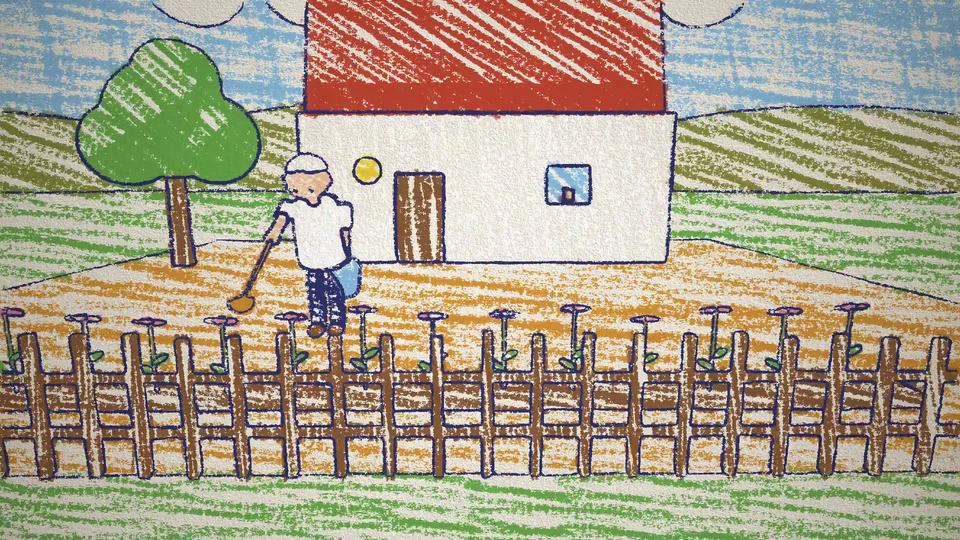</a> | A real 3D place, drawn. | plan-ready |
| [Glass Product Render](style/glass-product/SKILL.md)<br>`glass-product` | <a href="style/glass-product/sample.png">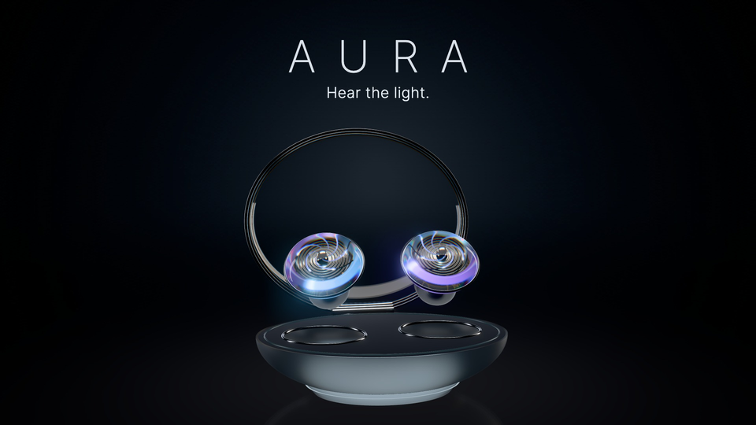</a> | A single hero object of glass, metal and light floating in an infinite black studio. | plan-ready |
| [Isometric People Scene](style/isometric-picture-book/SKILL.md)<br>`isometric-picture-book` | <a href="style/isometric-picture-book/sample.png">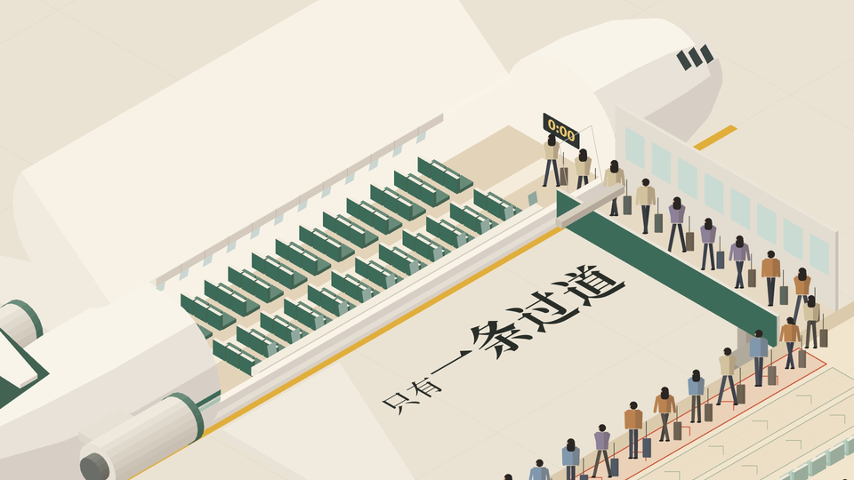</a> | One real place, full bleed. | plan-ready |
| [Low-poly Isometric Island](style/lowpoly-island/SKILL.md)<br>`lowpoly-island` | <a href="style/lowpoly-island/sample.png">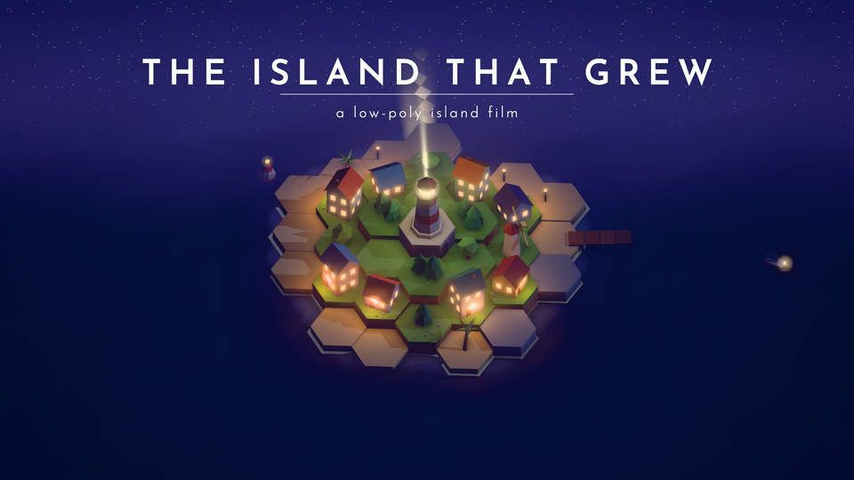</a> | A miniature world built from flat-shaded low-poly geometry (hexagonal tile columns, box buildings with prism roofs, cone and icosahedron. | plan-ready |
| [Memphis Diorama](style/memphis-diorama/SKILL.md)<br>`memphis-diorama` | <a href="style/memphis-diorama/sample.png">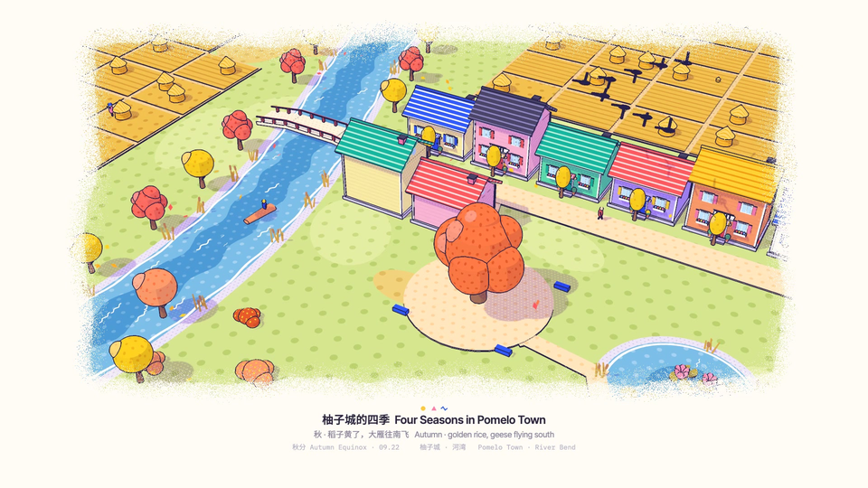</a> | Paper and a grainy frame. | plan-ready |
| [Paper Pop-up Book](style/paper-popup/SKILL.md)<br>`paper-popup` | <a href="style/paper-popup/sample.png">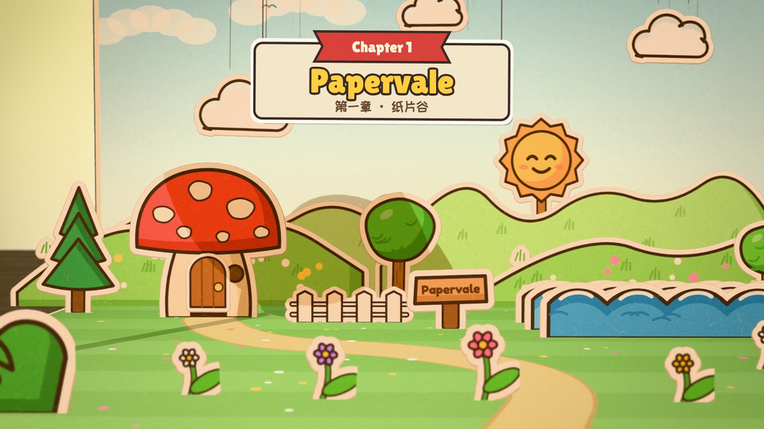</a> | Two worlds in one frame. | plan-ready |
| [Tilt-Shift Miniature](style/tilt-shift/SKILL.md)<br>`tilt-shift` | <a href="style/tilt-shift/sample.png">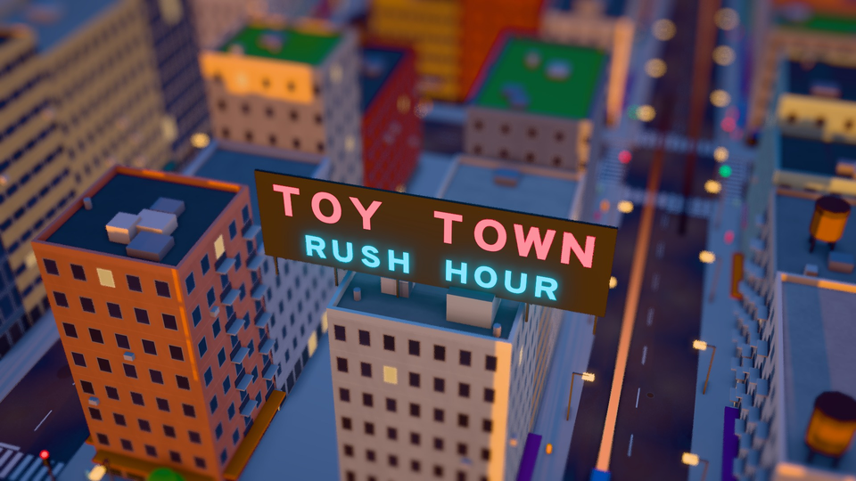</a> | A place seen from high up through a tilt-shift lens: only a thin horizontal strip of the frame is sharp, everything above and below melts. | plan-ready |

## Cartoons

| Style | Contoh | Keterangan | Status |
|---|---|---|---|
| [80s Cel Anime](style/cel-anime-80s/SKILL.md)<br>`cel-anime-80s` | <a href="style/cel-anime-80s/sample.png">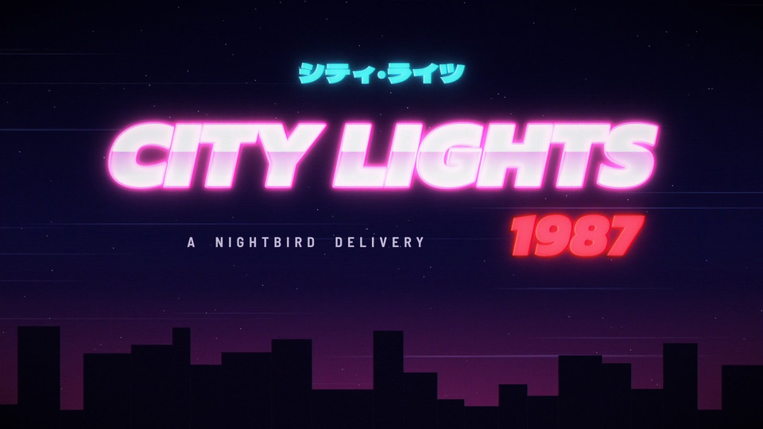</a> | Background painting: soft airbrushed gradients, glowing windows, wet reflections; painted once at load (colour + emissive pair), then only. | plan-ready |
| [Comic History Cartoon](style/comic-history/SKILL.md)<br>`comic-history` | <a href="style/comic-history/sample.png">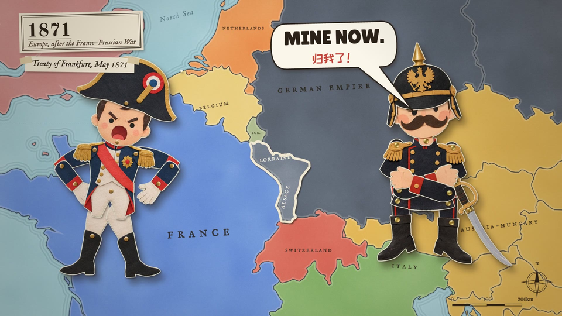</a> | Every change of territory is a paper action. | plan-ready |
| [Manga Panels](style/manga-panels/SKILL.md)<br>`manga-panels` | <a href="style/manga-panels/sample.png">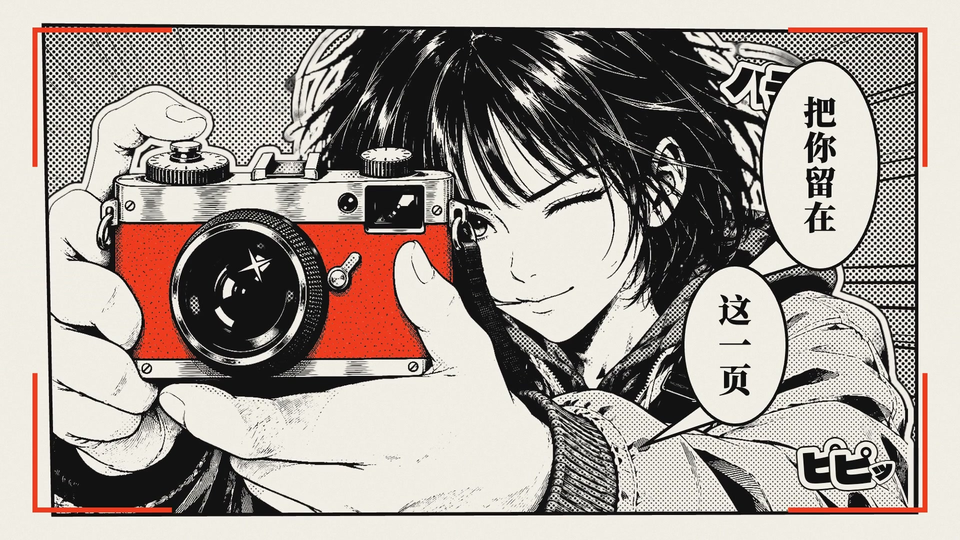</a> | A black-and-white Japanese manga page that moves: G-pen ink, screentone dots, one spot colour, panels that open on the beat, sound effects slammed… | plan-ready |
| [Mid-century Cartoon](style/midcentury-toon/SKILL.md)<br>`midcentury-toon` | <a href="style/midcentury-toon/sample.png">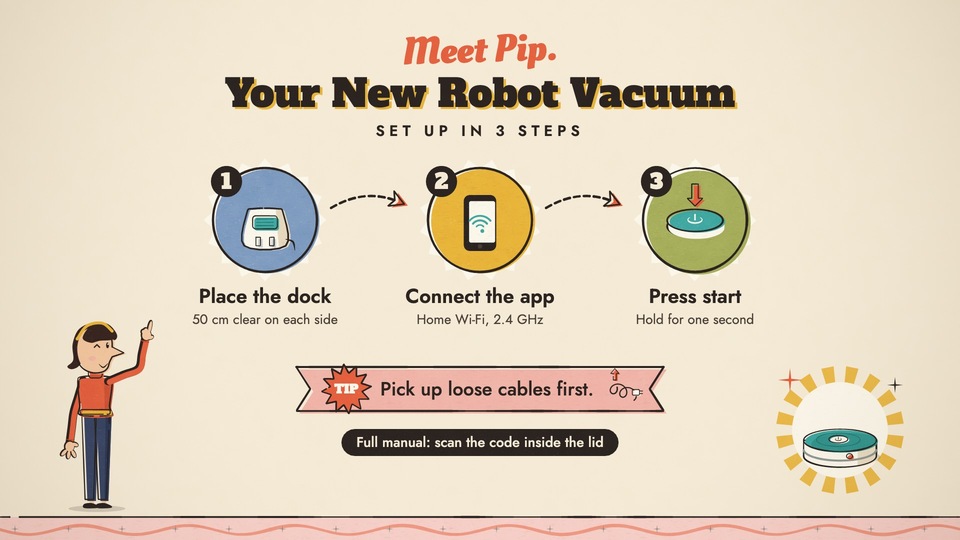</a> | Flat, printed-looking colour with a thin, breathing ink line that never quite closes. | plan-ready |
| [1930s Rubber Hose Cartoon](style/rubber-hose/SKILL.md)<br>`rubber-hose` | <a href="style/rubber-hose/sample.png">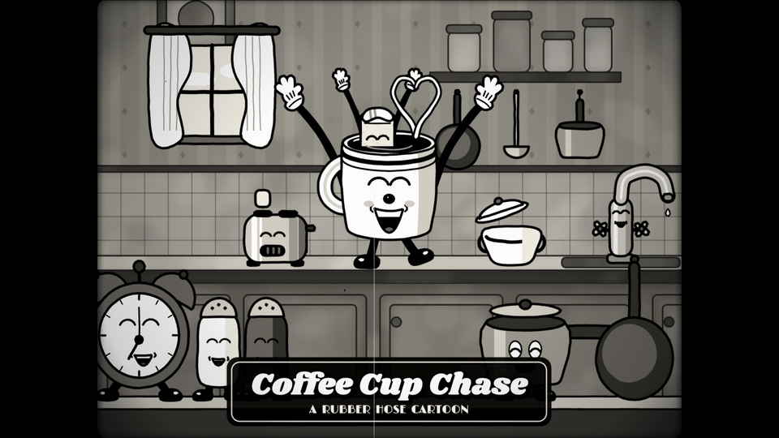</a> | Hand-inked black-and-white animation from the early sound era: characters with rubber-hose limbs (equal-width tubes, no elbows, no knees). | plan-ready |
| [Sci-Fi Sitcom Toon](style/scifi-toon/SKILL.md)<br>`scifi-toon` | <a href="style/scifi-toon/sample.png">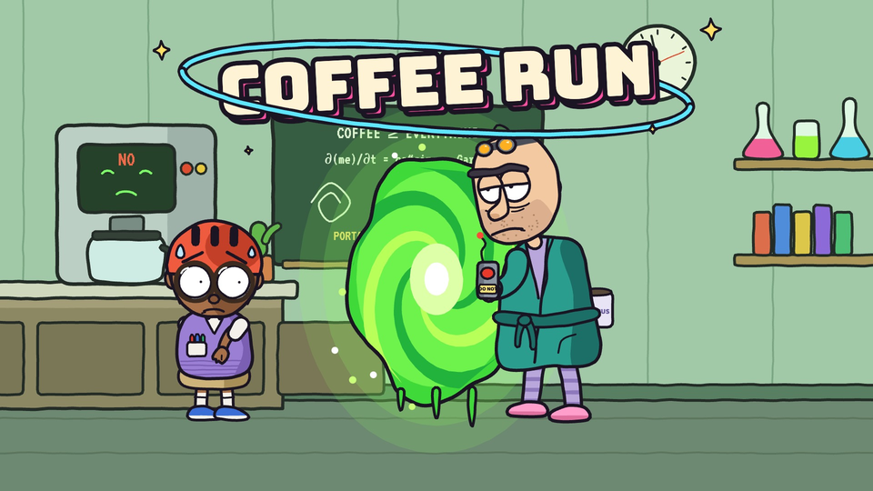</a> | Adult-animation sci-fi sitcom: thick boiling outlines, flat colour, a duo whose reactions don't match, a glowing portal, and one palette per world. | plan-ready |

## Data & Maps

| Style | Contoh | Keterangan | Status |
|---|---|---|---|
| [Data Physicalization](style/data-physical/SKILL.md)<br>`data-physical` | <a href="style/data-physical/sample.png">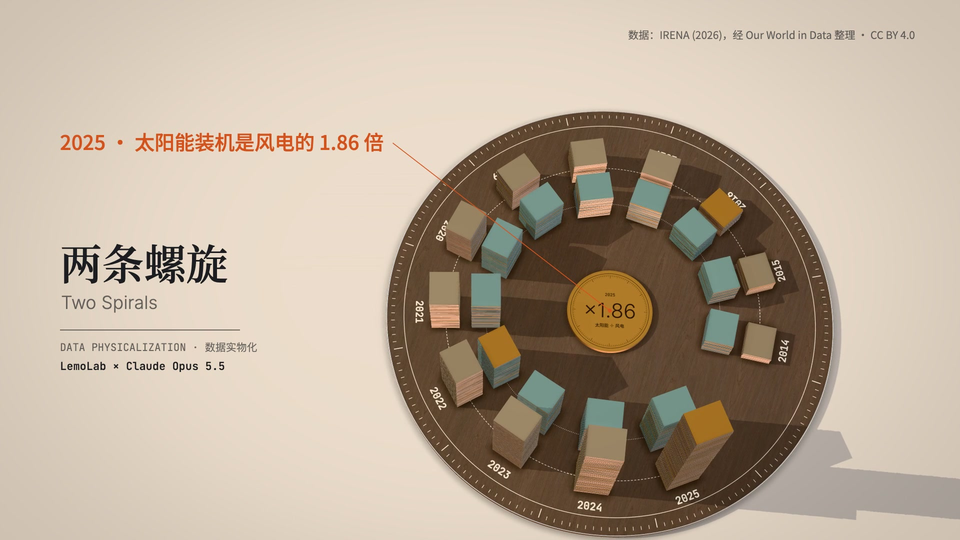</a> | The unit is an object. | plan-ready |
| [Data Storytelling](style/dataviz/SKILL.md)<br>`dataviz` | <a href="style/dataviz/sample.png">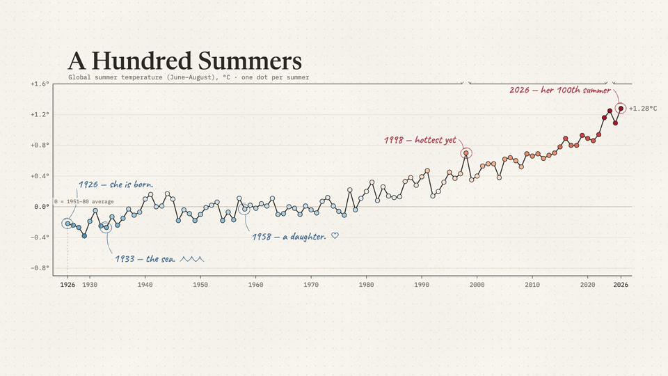</a> | The chart is the film. | plan-ready |
| [3D Map Explainer](style/map-explainer/SKILL.md)<br>`map-explainer` | <a href="style/map-explainer/sample.png">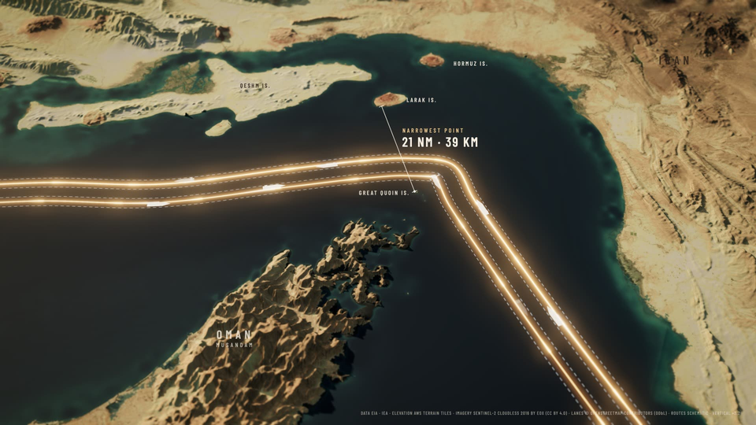</a> | The ground is real data. | plan-ready |
| [Blob Simulation](style/pip-simulation/SKILL.md)<br>`pip-simulation` | <a href="style/pip-simulation/sample.png">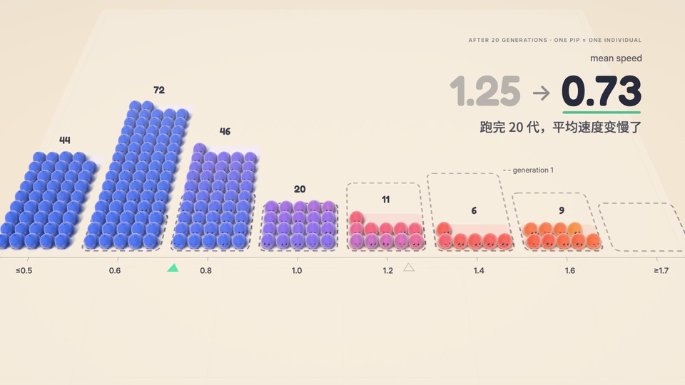</a> | The simulation is real. | plan-ready |
| [Transit Map](style/transit-map/SKILL.md)<br>`transit-map` | <a href="style/transit-map/sample.png">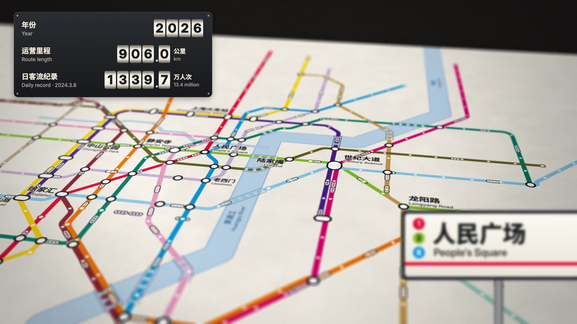</a> | Eight directions only. | plan-ready |
| [Projection-Mapped Model](style/white-model/SKILL.md)<br>`white-model` | <a href="style/white-model/sample.png">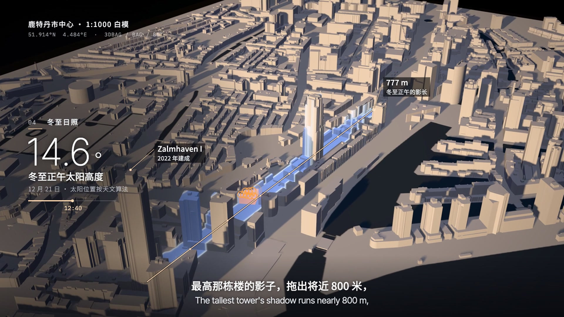</a> | The model is real geometry of a real place. | plan-ready |

## Edit & Documentary

| Style | Contoh | Keterangan | Status |
|---|---|---|---|
| [Caption News](style/caption-news/SKILL.md)<br>`caption-news` | <a href="style/caption-news/sample.png">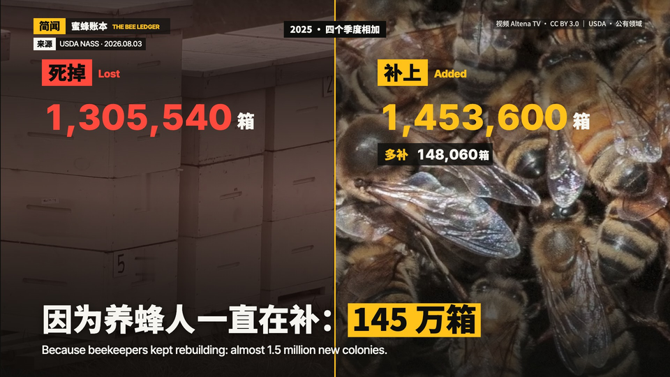</a> | Social-video news that reads with the sound off. | plan-ready |
| [City Symphony](style/city-symphony/SKILL.md)<br>`city-symphony` | <a href="style/city-symphony/sample.png">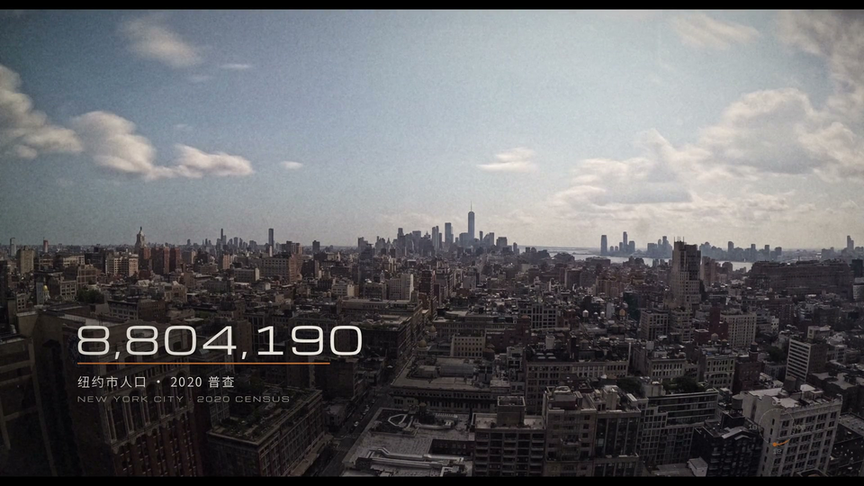</a> | A city film cut like a piece of minimalist music: time-lapse turns traffic, crowds and clouds into rivers of light, the cuts get denser with the sc… | plan-ready |
| [Live Countdown Split-screen](style/countdown/SKILL.md)<br>`countdown` | <a href="style/countdown/sample.png">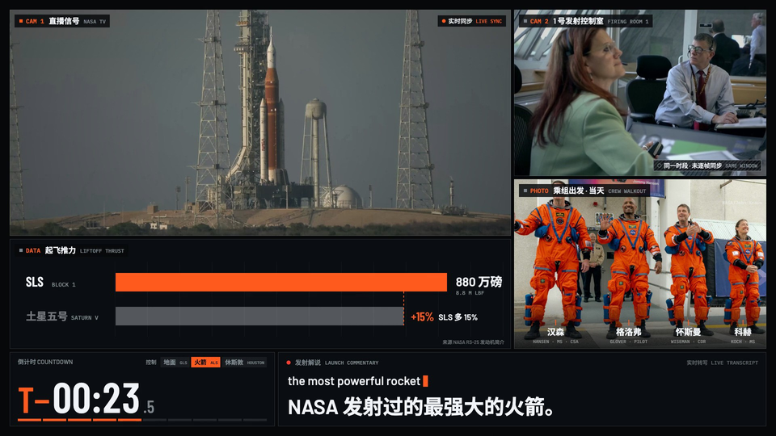</a> | An edit style, not a look. | plan-ready |
| [Constructivist Montage](style/kino-montage/SKILL.md)<br>`kino-montage` | <a href="style/kino-montage/sample.png">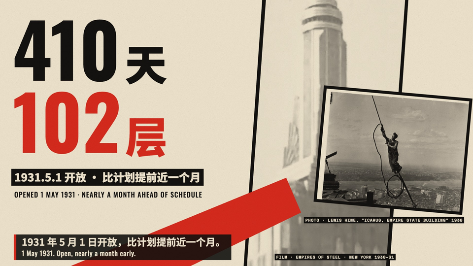</a> | Real archive footage, photographs and documents, printed as one ink-and-paper poster with a single red, and cut on a machine beat. | plan-ready |
| [Broadcast News Package](style/news-package/SKILL.md)<br>`news-package` | <a href="style/news-package/sample.png">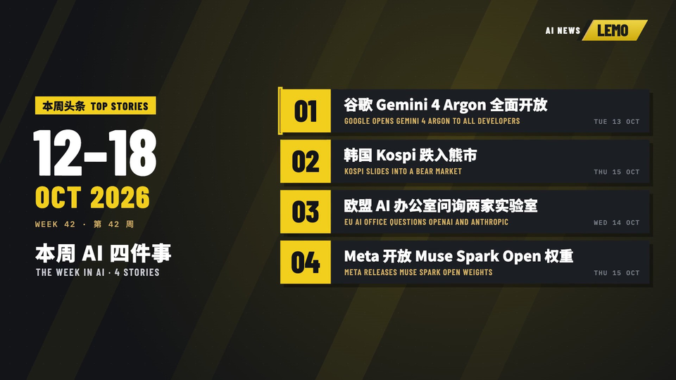</a> | One package system, used consistently. | plan-ready |
| [1920s Newsreel](style/newsreel/SKILL.md)<br>`newsreel` | <a href="style/newsreel/sample.png">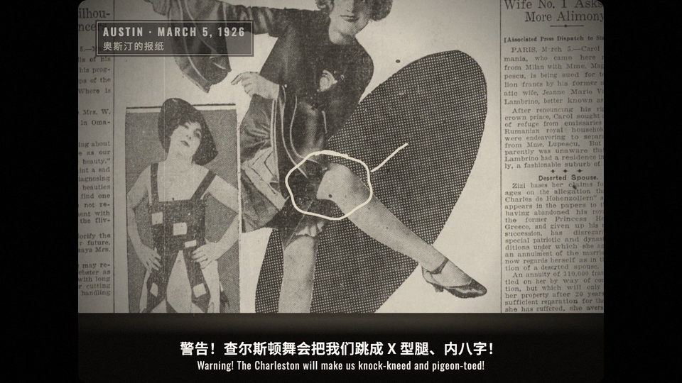</a> | Archive in a projected gate. | plan-ready |
| [Sports Telestrator](style/telestrator/SKILL.md)<br>`telestrator` | <a href="style/telestrator/sample.png">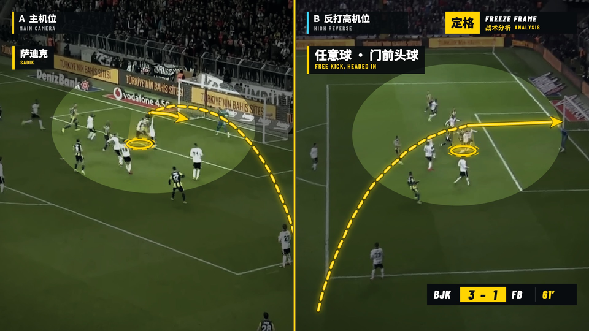</a> | Watch it, then take it apart. | plan-ready |
| [Visual Investigation](style/visual-investigation/SKILL.md)<br>`visual-investigation` | <a href="style/visual-investigation/sample.png">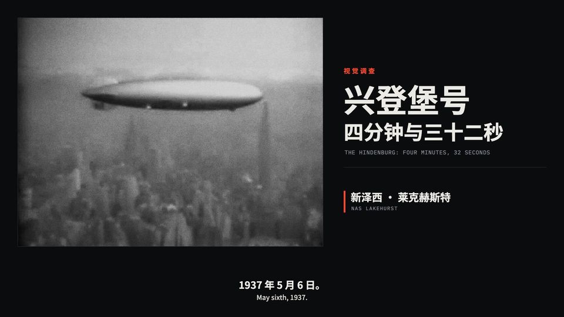</a> | Sources meet at one moment. | plan-ready |

## Film & Tape

| Style | Contoh | Keterangan | Status |
|---|---|---|---|
| [CRT ASCII Terminal](style/ascii-crt/SKILL.md)<br>`ascii-crt` | <a href="style/ascii-crt/sample.png">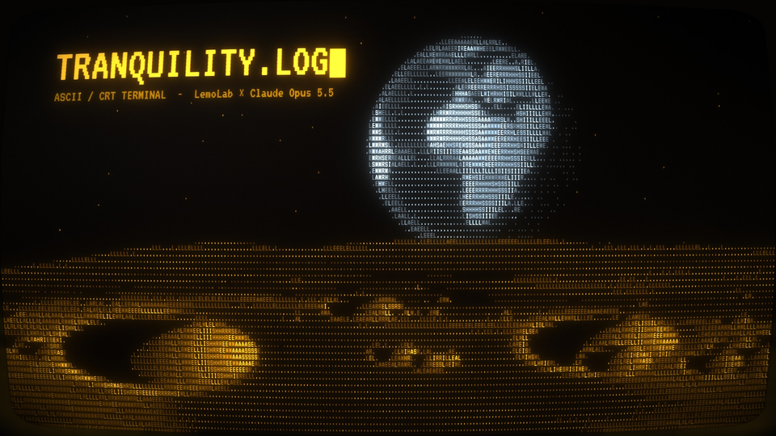</a> | Everything on screen is a real character on a monospace grid, lit by the phosphor of an old monochrome CRT. | plan-ready |
| [Liminal Found Footage](style/backrooms/SKILL.md)<br>`backrooms` | <a href="style/backrooms/sample.png">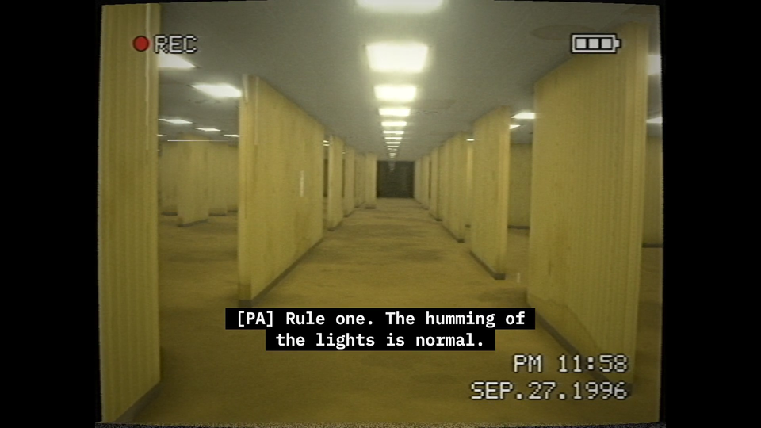</a> | One first-person camcorder recording. | plan-ready |
| [Double Exposure](style/double-exposure/SKILL.md)<br>`double-exposure` | <a href="style/double-exposure/sample.png">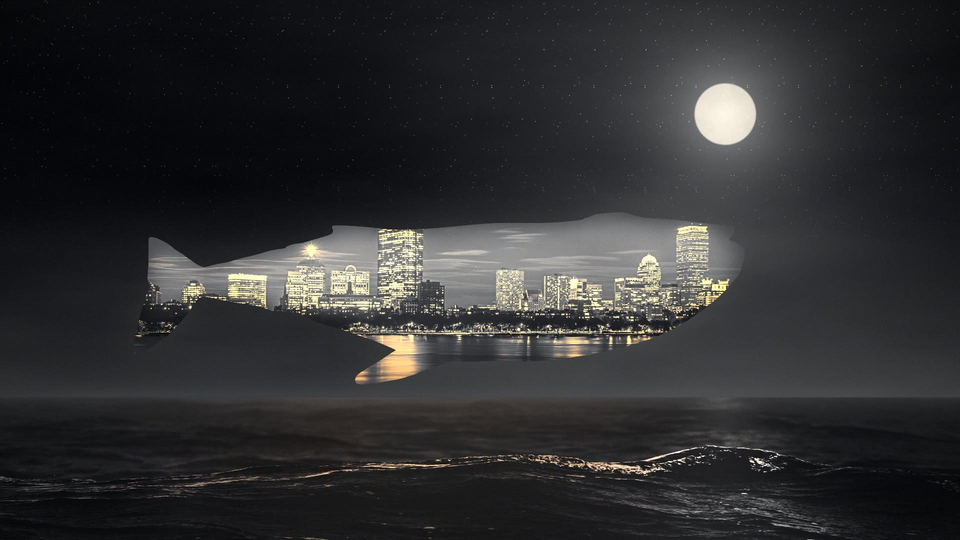</a> | Animal silhouette × landscape. | plan-ready |
| [Scratch Film](style/scratch-film/SKILL.md)<br>`scratch-film` | <a href="style/scratch-film/sample.png">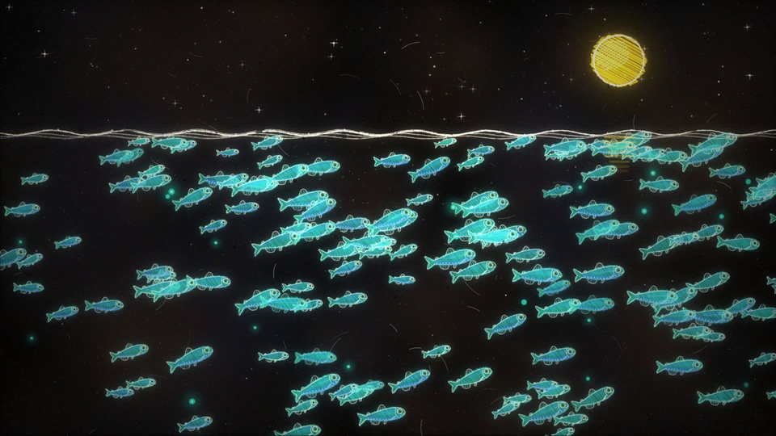</a> | Black is the ground, light is a cut. | plan-ready |
| [1920s Silent Film](style/silent-film/SKILL.md)<br>`silent-film` | <a href="style/silent-film/sample.png">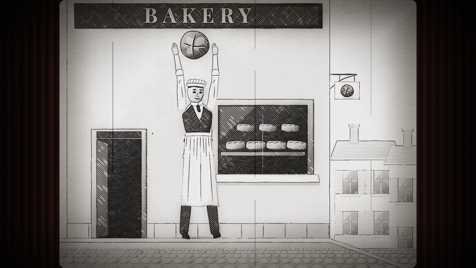</a> | A 4:3 print in a gate between theatre curtains. | plan-ready |

## Games

| Style | Contoh | Keterangan | Status |
|---|---|---|---|
| [Rhythm Game Show](style/game-show/SKILL.md)<br>`game-show` | <a href="style/game-show/sample.png">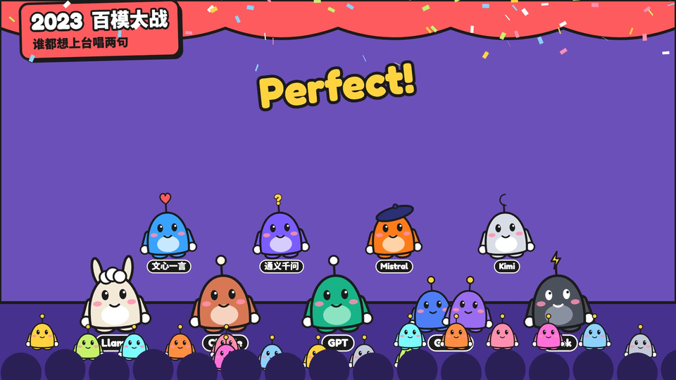</a> | Everything is on the grid. | plan-ready |
| [2.5D Pixel Art](style/hd-2d/SKILL.md)<br>`hd-2d` | <a href="style/hd-2d/sample.png">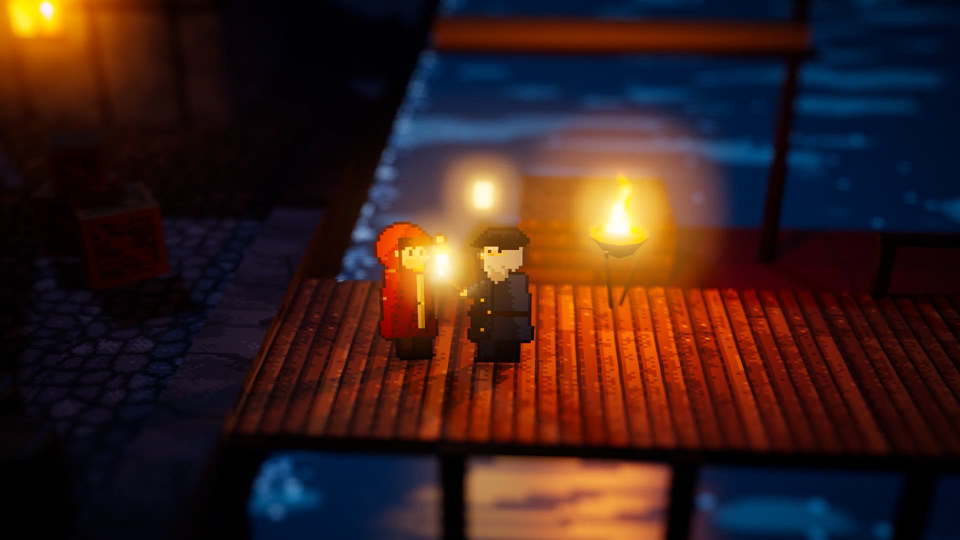</a> | A 3D miniature set of boxes and cylinders wrapped in pixel-art textures, populated by flat 2D pixel sprites that receive light and cast. | plan-ready |
| [Microgame Frenzy](style/microgame/SKILL.md)<br>`microgame` | <a href="style/microgame/sample.png">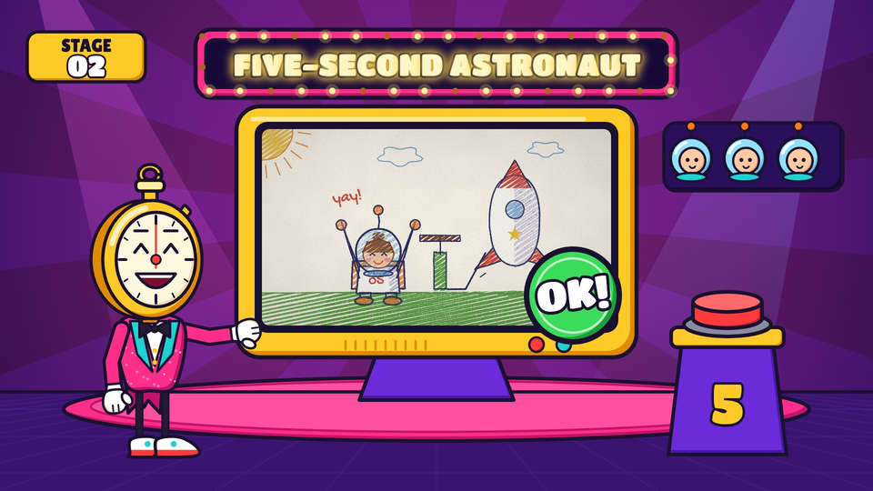</a> | A microgame = a shouted command word + 2.5–4 s + one action + one result. | plan-ready |
| [16-bit Pixel RPG](style/pixel-rpg/SKILL.md)<br>`pixel-rpg` | <a href="style/pixel-rpg/sample.png">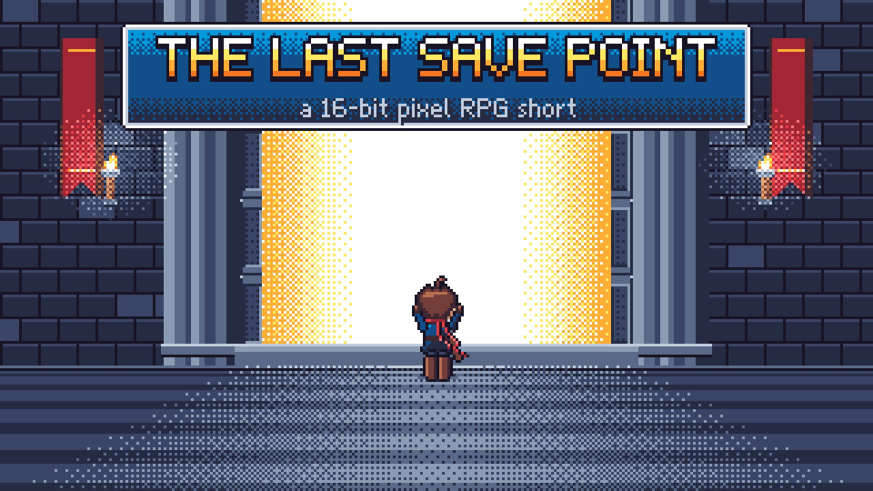</a> | 320×180 native pixels, scaled ×6 nearest-neighbour to 1080p; everything, text included, lives in the framebuffer. | plan-ready |

## Graphic & Type

| Style | Contoh | Keterangan | Status |
|---|---|---|---|
| [Art Deco](style/art-deco/SKILL.md)<br>`art-deco` | <a href="style/art-deco/sample.png">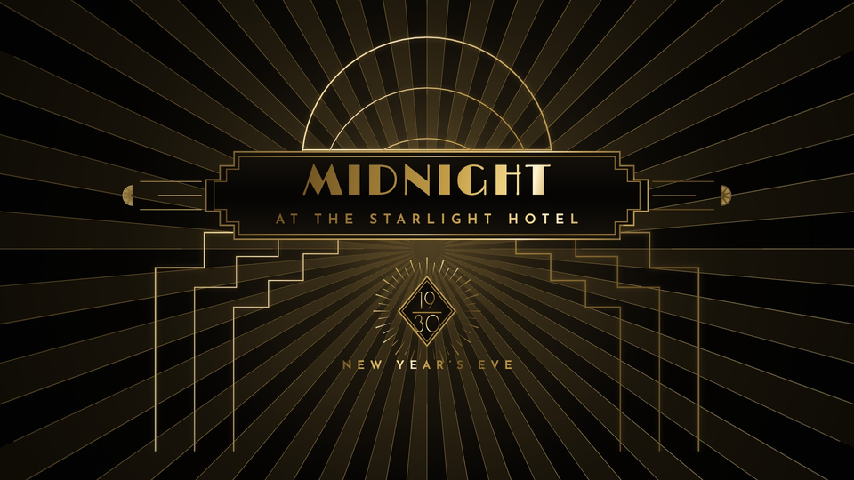</a> | A world built from gold keylines on warm black, filled with airbrushed hard-edged volumes (Cassandre, Lempicka), organised around one. | plan-ready |
| [Bauhaus Shapes](style/bauhaus-shapes/SKILL.md)<br>`bauhaus-shapes` | <a href="style/bauhaus-shapes/sample.png">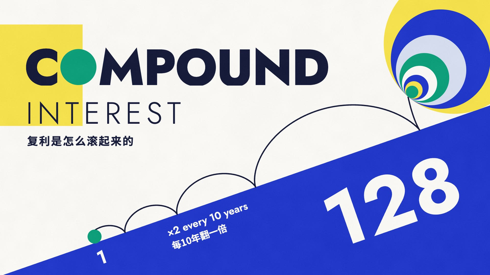</a> | An explainer told only with circles, squares, triangles, arcs and straight lines, set in opaque colour on a light, matte paper. | plan-ready |
| [Scale Zoom Explainer](style/flat-space-explainer/SKILL.md)<br>`flat-space-explainer` | <a href="style/flat-space-explainer/sample.png">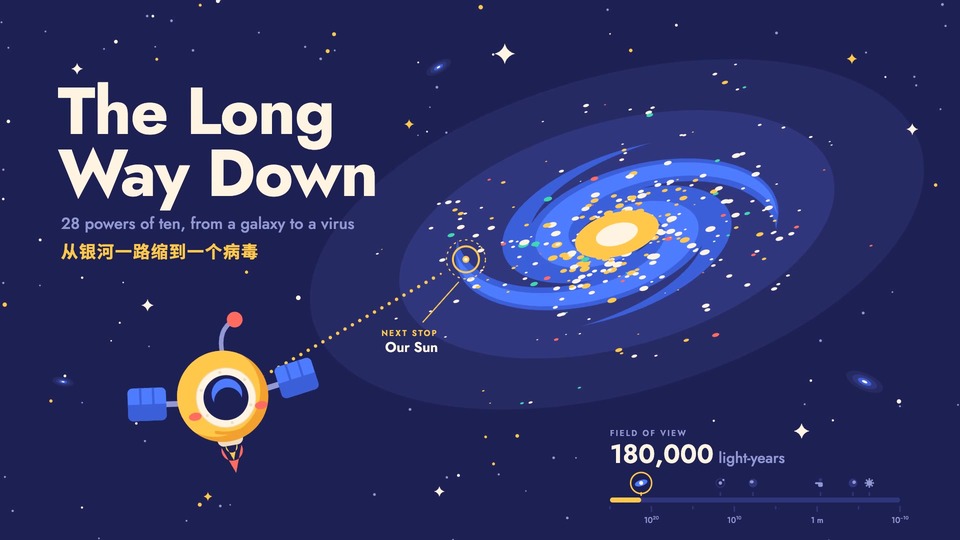</a> | Flat and opaque: every object is a solid colour plus at most one shade step. | plan-ready |
| [Pictogram Motion](style/pictogram-motion/SKILL.md)<br>`pictogram-motion` | <a href="style/pictogram-motion/sample.png">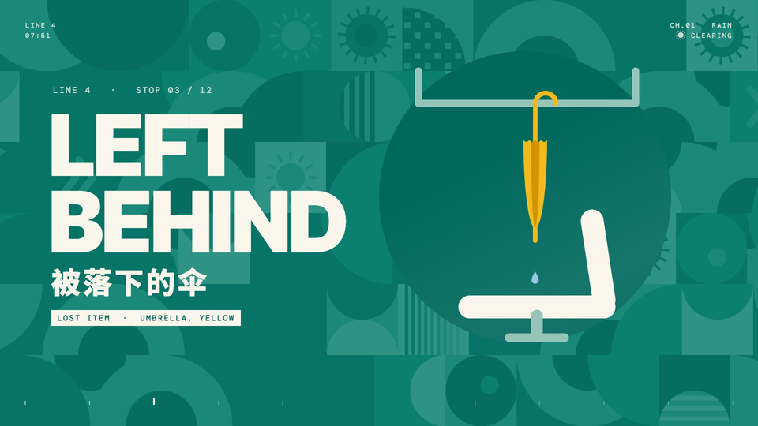</a> | The grid pattern: big discs and half-discs spanning square cells, about half the cells carrying a small motif, all in five tones of one. | plan-ready |
| [Silhouette Rhythm](style/silhouette-rhythm/SKILL.md)<br>`silhouette-rhythm` | <a href="style/silhouette-rhythm/sample.png">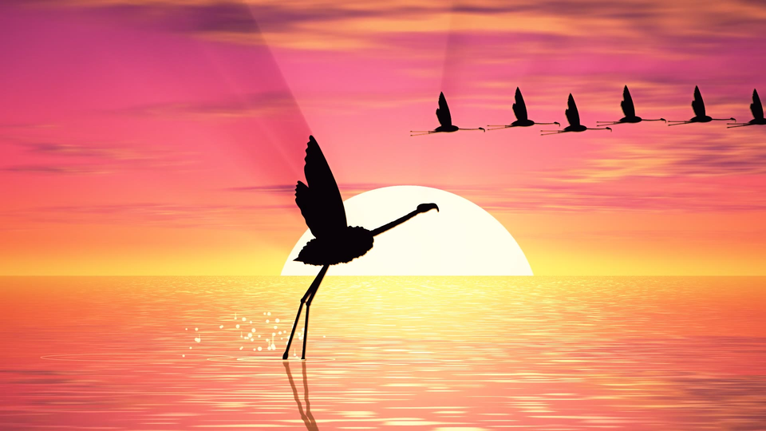</a> | The figure is one black shape. | plan-ready |
| [60s Spy Title Sequence](style/spy-titles/SKILL.md)<br>`spy-titles` | <a href="style/spy-titles/sample.png">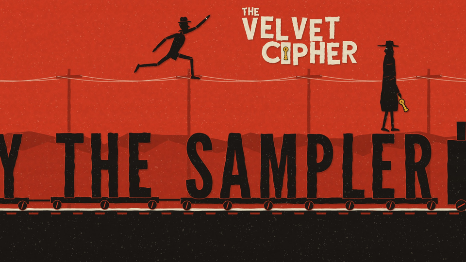</a> | Flat, opaque inks on paper. | plan-ready |
| [Swiss Motion Graphics](style/swiss-motion/SKILL.md)<br>`swiss-motion` | <a href="style/swiss-motion/sample.png">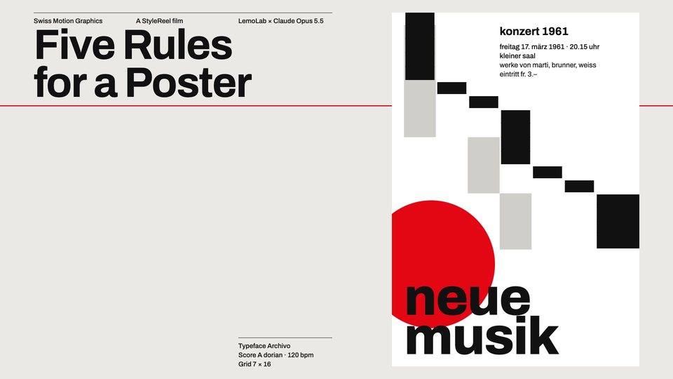</a> | Pure 2D graphic design animated on a grid. | plan-ready |
| [Text Flash Cuts](style/text-flash-cuts/SKILL.md)<br>`text-flash-cuts` | <a href="style/text-flash-cuts/sample.png">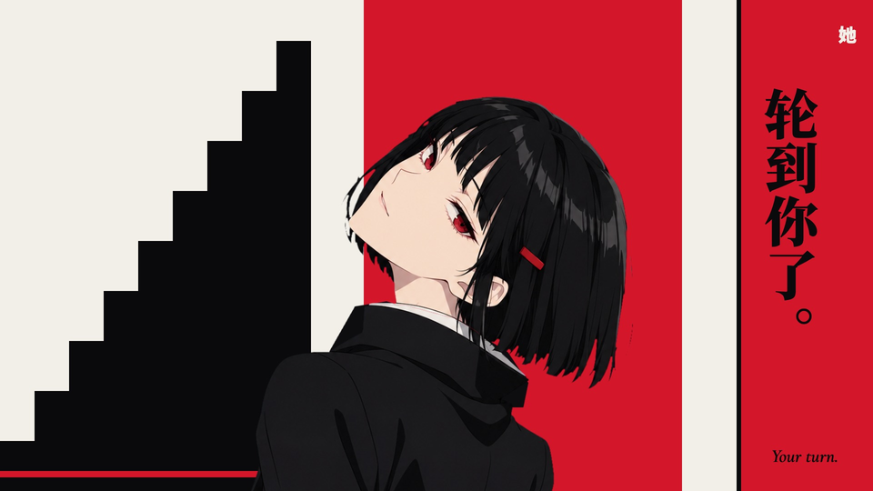</a> | Avant-garde TV anime in the manner of the early-2000s "text frame" school: full-screen heavy Mincho title cards cut in for two to nine frames, arch… | plan-ready |

## Instruments & Evidence

| Style | Contoh | Keterangan | Status |
|---|---|---|---|
| [Archive Light Table](style/archive-lighttable/SKILL.md)<br>`archive-lighttable` | <a href="style/archive-lighttable/sample.png">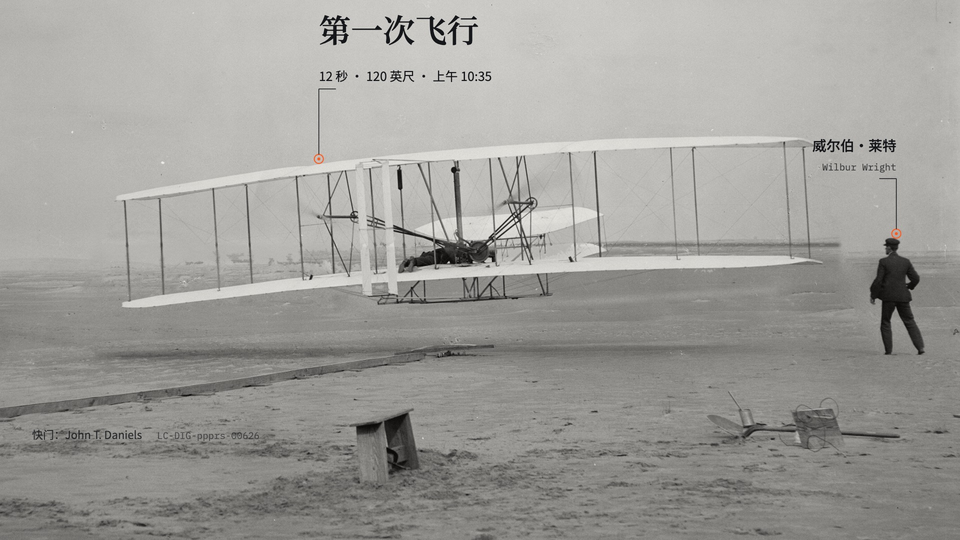</a> | The objects are real. | plan-ready |
| [Engineering Briefing Board](style/briefing-board/SKILL.md)<br>`briefing-board` | <a href="style/briefing-board/sample.png">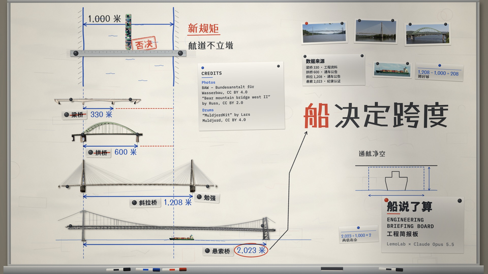</a> | A physical board in a room. | plan-ready |
| [Radar Sweep Documentary](style/dark-documentary/SKILL.md)<br>`dark-documentary` | <a href="style/dark-documentary/sample.png">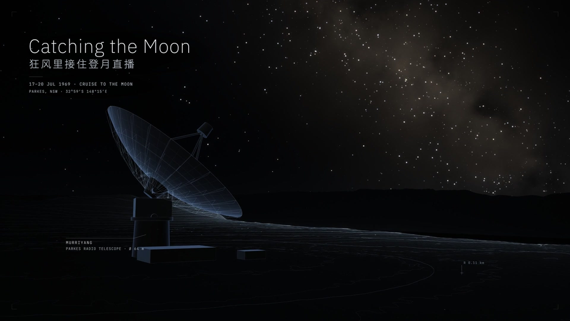</a> | Existence is scanned. | plan-ready |
| [LiDAR Survey](style/lidar-survey/SKILL.md)<br>`lidar-survey` | <a href="style/lidar-survey/sample.png">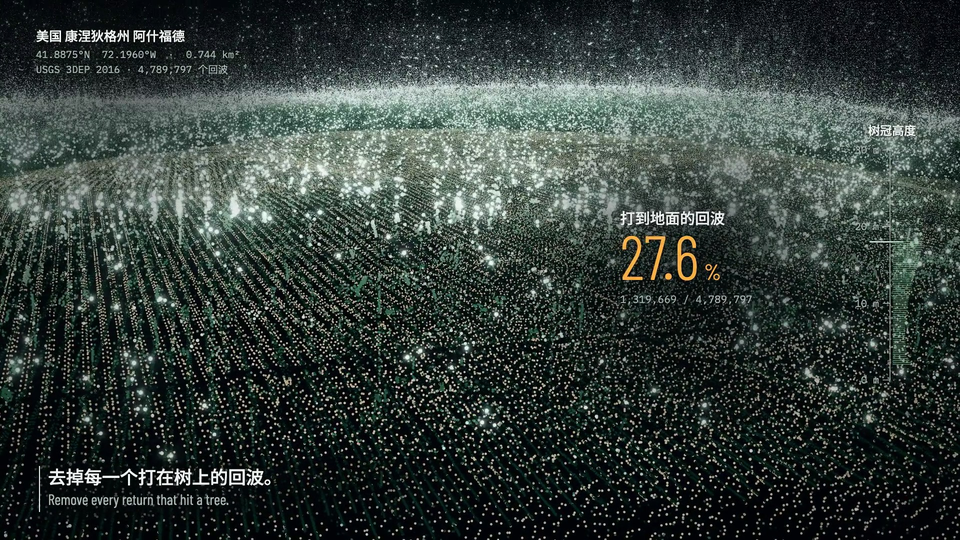</a> | The cloud is the data. | plan-ready |
| [Under the Microscope](style/microscope/SKILL.md)<br>`microscope` | <a href="style/microscope/sample.png">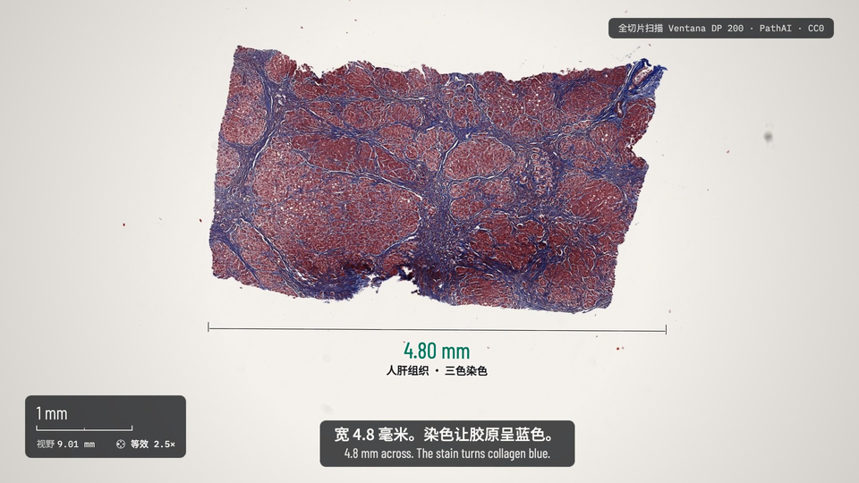</a> | The specimen is a photograph. | plan-ready |
| [Satellite Briefing](style/satellite-briefing/SKILL.md)<br>`satellite-briefing` | <a href="style/satellite-briefing/sample.png"></a> | The ground is a photograph. | plan-ready |
| [Security X-ray](style/security-xray/SKILL.md)<br>`security-xray` | <a href="style/security-xray/sample.png"></a> | Transmission, not rendering. | plan-ready |
| [Thermal Camera](style/thermal-camera/SKILL.md)<br>`thermal-camera` | <a href="style/thermal-camera/sample.png"></a> | Temperature is the picture. | plan-ready |

## Light & Lines

| Style | Contoh | Keterangan | Status |
|---|---|---|---|
| [Circuit Board](style/circuit-board/SKILL.md)<br>`circuit-board` | <a href="style/circuit-board/sample.png"></a> | A top-down board in every frame: copper pour with clearances cut around everything, traces with 0/45/90° runs and mitred corners, gold pads. | plan-ready |
| [Firefly Pointillism](style/firefly-pointillism/SKILL.md)<br>`firefly-pointillism` | <a href="style/firefly-pointillism/sample.png"></a> | Black is more than half the frame. | plan-ready |
| [Flow-field Wind Lines](style/flow-field/SKILL.md)<br>`flow-field` | <a href="style/flow-field/sample.png"></a> | Every line is a streamline of a real field. | plan-ready |
| [Neon Tubes](style/neon-tubes/SKILL.md)<br>`neon-tubes` | <a href="style/neon-tubes/sample.png"></a> | Real neon signs on a rainy night street: bent glass tubes filled with gas on painted boards, striking with a flicker, lighting the wet walls and do… | plan-ready |
| [Oscilloscope Math](style/oscilloscope-math/SKILL.md)<br>`oscilloscope-math` | <a href="style/oscilloscope-math/sample.png"></a> | Mathematics drawn by an electron beam on a phosphor screen: thin glowing green lines on near-black, a dotted graticule, monospace readouts and TeX… | plan-ready |

## Line Diagrams

| Style | Contoh | Keterangan | Status |
|---|---|---|---|
| [Assembly-Line Diagram](style/assembly-line-diagram/SKILL.md)<br>`assembly-line-diagram` | <a href="style/assembly-line-diagram/sample.png"></a> | One line, one direction. | plan-ready |
| [Blueprint](style/blueprint/SKILL.md)<br>`blueprint` | <a href="style/blueprint/sample.png"></a> | The whole film happens on one sheet of blueprint paper. | plan-ready |
| [Line-Art Cutaway](style/hardcore-info/SKILL.md)<br>`hardcore-info` | <a href="style/hardcore-info/sample.png"></a> | Everything is line on paper. | plan-ready |
| [Instruction Manual Art](style/instruction-manual/SKILL.md)<br>`instruction-manual` | <a href="style/instruction-manual/sample.png"></a> | One angle: true isometric, orthographic. | plan-ready |
| [Isometric Infographic](style/iso-infographic/SKILL.md)<br>`iso-infographic` | <a href="style/iso-infographic/sample.png"></a> | Flat, true isometric. | plan-ready |
| [Pen Plotter](style/pen-plotter/SKILL.md)<br>`pen-plotter` | <a href="style/pen-plotter/sample.png"></a> | Every mark is a stroke. | plan-ready |
| [Color-Coded Mechanism](style/precise-mechanism/SKILL.md)<br>`precise-mechanism` | <a href="style/precise-mechanism/sample.png"></a> | Colour is the structure. | plan-ready |
| [Exploded Teardown](style/teardown/SKILL.md)<br>`teardown` | <a href="style/teardown/sample.png"></a> | The object is real and exact. | plan-ready |

## Other

| Style | Contoh | Keterangan | Status |
|---|---|---|---|
| [Bang Motion](style/bang-motion/SKILL.md)<br>`bang-motion` | <a href="style/bang-motion/sample.png"></a> | High-end motion design style ported from bang-motion. Multi-layer glowing horizon backgrounds, soft film grain, glassmorphic UI cards, kinetic edit… | plan-ready |
| [Crosshatch](style/crosshatch/SKILL.md)<br>`crosshatch` | <a href="style/crosshatch/sample.png"></a> | Short vertical explainer style. Every shape has a hatch/pencil/stipple texture shaped by light. | plan-ready |
| [Cut Paper (Collage)](style/cut-paper/SKILL.md)<br>`cut-paper` | <a href="style/cut-paper/sample.png"></a> | Collage-style cut-paper animation. Full-bleed colour worlds, crayon/pattern textures, layered paper parts and orange spark mascot. | plan-ready |
| [Isometric](style/isometric/SKILL.md)<br>`isometric` | <a href="style/isometric/sample.png"></a> | Clean isometric product illustration style on light/dark ground. 2.0px constant hairlines, rounded slabs, stacked layers and spring motion on 1s. | plan-ready |
| [Line Art Animation](style/line-art-animation/SKILL.md)<br>`line-art-animation` | <a href="style/line-art-animation/sample.png"></a> | Hand-drawn Japanese and European ink line-art aesthetic. Crisp SVG path rendering, constant hairline pen weights (1.5–2.5px), animated gait solvers… | plan-ready |
| [Math (Manim)](style/math/SKILL.md)<br>`math` | <a href="style/math/sample.png"></a> | Mathematical visual explainer. Color-coded formulas, axes and graphs with ShowCreation sweeps, Transform morphs and little pi hero. | plan-ready |
| [Papercut](style/papercut/SKILL.md)<br>`papercut` | <a href="style/papercut/sample.png"></a> | Short vertical (9:16) explainer style. Every prop is paper: grain, a rough cut edge, a drop shadow, stacked darker/lighter pieces instead of outlin… | plan-ready |
| [Pixel Art](style/pixel/SKILL.md)<br>`pixel` | <a href="style/pixel/sample.png"></a> | Retro pixel art style. Dithered shading, 5x7 bitmap typography, CRT/scanline/LCD effects and resolution eras that tell time. | plan-ready |
| [Risograph](style/riso/SKILL.md)<br>`riso` | <a href="style/riso/sample.png"></a> | Physical print shop look. Pure CMY/spot ink separation, halftone screens at distinct angles, mechanical misregistration and paper grain. | plan-ready |
| [Sketchbook](style/sketchbook/SKILL.md)<br>`sketchbook` | <a href="style/sketchbook/sample.png"></a> | Notebook concept explainer. Hand-drawn wobbly graphite lines, quick scribble fills, dot-grid paper and smudges with continuous camera panning. | plan-ready |

## Painting & Illustration

| Style | Contoh | Keterangan | Status |
|---|---|---|---|
| [Colored-Pencil Science Illustration](style/colored-pencil/SKILL.md)<br>`colored-pencil` | <a href="style/colored-pencil/sample.png"></a> | The whole frame is one pencil drawing. | plan-ready |
| [Crayon Picture Book](style/crayon-book/SKILL.md)<br>`crayon-book` | <a href="style/crayon-book/sample.png"></a> | A children's picture book page being drawn while you watch: wax crayon on warm off-white paper, a limited box of crayons, child-logic. | plan-ready |
| [Impasto Oil Painting](style/impasto/SKILL.md)<br>`impasto` | <a href="style/impasto/sample.png"></a> | A moving oil painting made of knife strokes. | plan-ready |
| [Urban Sketch · Pen & Wash](style/urban-sketch/SKILL.md)<br>`urban-sketch` | <a href="style/urban-sketch/sample.png"></a> | A sketchbook page drawn on location: fine sepia fineliner lines that wobble, overshoot and never quite close, with loose transparent watercolour dr… | plan-ready |
| [Watercolor Brush](style/watercolor/SKILL.md)<br>`watercolor` | <a href="style/watercolor/sample.png"></a> | One sheet of warm, fibrous paper. | plan-ready |

## Print & Printmaking

| Style | Contoh | Keterangan | Status |
|---|---|---|---|
| [Copperplate Engraving](style/engraving/SKILL.md)<br>`engraving` | <a href="style/engraving/sample.png"></a> | Tone is made of lines, never of fills. | plan-ready |
| [Halftone Dossier](style/halftone-dossier/SKILL.md)<br>`halftone-dossier` | <a href="style/halftone-dossier/sample.png"></a> | The whole film is paper. | plan-ready |
| [Pop Art](style/pop-art/SKILL.md)<br>`pop-art` | <a href="style/pop-art/sample.png"></a> | A printed object, not an illustration. | plan-ready |
| [Scratchboard Long Take](style/printed-long-take/SKILL.md)<br>`printed-long-take` | <a href="style/printed-long-take/sample.png"></a> | Only ink, paper and one red. | plan-ready |
| [Risograph Print](style/risograph/SKILL.md)<br>`risograph` | <a href="style/risograph/sample.png"></a> | A tiny palette: 2–3 spot inks on warm off-white paper. | plan-ready |
| [Silkscreen Travel Poster](style/silkscreen-poster/SKILL.md)<br>`silkscreen-poster` | <a href="style/silkscreen-poster/sample.png"></a> | Registration: every layer offset 1–3 px at 1080p; a knocked-out shape leaves a crescent of bare paper. | plan-ready |
| [Vintage Engraving Collage](style/vintage-collage/SKILL.md)<br>`vintage-collage` | <a href="style/vintage-collage/sample.png"></a> | Real printed matter, cut by hand. | plan-ready |
| [Woodcut Print](style/woodcut/SKILL.md)<br>`woodcut` | <a href="style/woodcut/sample.png"></a> | Black is the wood, white is what the knife removed. | plan-ready |

## Screens & Interfaces

| Style | Contoh | Keterangan | Status |
|---|---|---|---|
| [Dark Tech Keynote](style/dark-keynote/SKILL.md)<br>`dark-keynote` | <a href="style/dark-keynote/sample.png"></a> | A keynote-grade product film for software. | plan-ready |
| [Tabletop App Flythrough](style/desktop-flythrough/SKILL.md)<br>`desktop-flythrough` | <a href="style/desktop-flythrough/sample.png"></a> | The desk is the world. | plan-ready |
| [Sci-fi Hologram HUD](style/hologram-hud/SKILL.md)<br>`hologram-hud` | <a href="style/hologram-hud/sample.png"></a> | The subject is always a line wireframe made of light above a round projector pad on a near-black stage, never a rendered object. | plan-ready |
| [Mascot Screencast](style/living-screencast/SKILL.md)<br>`living-screencast` | <a href="style/living-screencast/sample.png"></a> | Two actors, never a hand:. | plan-ready |
| [1-bit Dither](style/one-bit-dither/SKILL.md)<br>`one-bit-dither` | <a href="style/one-bit-dither/sample.png"></a> | A real 3D world shown with exactly two inks: every grey becomes a pattern of dots that is fixed to the surfaces, outlines come from depth and norma… | plan-ready |
| [Spreadsheet Film](style/spreadsheet/SKILL.md)<br>`spreadsheet` | <a href="style/spreadsheet/sample.png"></a> | Cells are the pixels, and they are wide. | plan-ready |

## Sketch & Board

| Style | Contoh | Keterangan | Status |
|---|---|---|---|
| [Chalkboard](style/chalkboard/SKILL.md)<br>`chalkboard` | <a href="style/chalkboard/sample.png"></a> | A clean, freshly wiped board. | plan-ready |
| [Tablet Sketch Explainer](style/ipad-sketch/SKILL.md)<br>`ipad-sketch` | <a href="style/ipad-sketch/sample.png"></a> | The whole frame is a cream drawing canvas on a tablet, seen while someone draws and explains: grainy pencil lines go down first, flat colour blocks… | plan-ready |
| [Marker on Paper](style/marker-paper/SKILL.md)<br>`marker-paper` | <a href="style/marker-paper/sample.png"></a> | The frame is the sheet. | plan-ready |
| [One-line Drawing](style/one-line/SKILL.md)<br>`one-line` | <a href="style/one-line/sample.png"></a> | One continuous line on warm white paper. | plan-ready |
| [Sketchnote](style/sketchnote/SKILL.md)<br>`sketchnote` | <a href="style/sketchnote/sample.png"></a> | The frame is the page. | plan-ready |
| [Stick-figure Explainer](style/stick-explainer/SKILL.md)<br>`stick-explainer` | <a href="style/stick-explainer/sample.png"></a> | The people are the diagram. | plan-ready |
| [Whiteboard Explainer](style/whiteboard/SKILL.md)<br>`whiteboard` | <a href="style/whiteboard/sample.png"></a> | One physical whiteboard. | plan-ready |

## Traditional Crafts

| Style | Contoh | Keterangan | Status |
|---|---|---|---|
| [Gilded Illumination](style/gilded-illumination/SKILL.md)<br>`gilded-illumination` | <a href="style/gilded-illumination/sample.png"></a> | Flat pigment, firm line. | plan-ready |
| [Chinese Ink Wash](style/ink-wash/SKILL.md)<br>`ink-wash` | <a href="style/ink-wash/sample.png"></a> | An ink painting (水墨) painted and unrolled before you: black ink on warm rice paper in five tones, plus one red, the vermilion seal. | plan-ready |
| [Paper-cut Lightbox](style/paper-lantern/SKILL.md)<br>`paper-lantern` | <a href="style/paper-lantern/sample.png"></a> | A paper layer: a flat cut sheet, one flat colour, fibre grain, a thin warm rim of light on its top edge and a dark band on its bottom edge. | plan-ready |
| [Red Paper-cut](style/papercut-red/SKILL.md)<br>`papercut-red` | <a href="style/papercut-red/sample.png"></a> | Every visible thing is a piece of paper that was cut with scissors and laid flat on another sheet. | plan-ready |
| [Shadow Puppetry](style/shadow-puppet/SKILL.md)<br>`shadow-puppet` | <a href="style/shadow-puppet/sample.png"></a> | A white cloth screen; behind it, flat puppets cut from translucent dyed hide, lit by an oil lamp. | plan-ready |
| [Stained Glass](style/stained-glass/SKILL.md)<br>`stained-glass` | <a href="style/stained-glass/sample.png"></a> | Cut pieces of coloured glass in dark lead cames. | plan-ready |
| [Ukiyo-e](style/ukiyoe/SKILL.md)<br>`ukiyoe` | <a href="style/ukiyoe/sample.png"></a> | Paper is always visible: warm washi, long fibres, slight edge ageing. | plan-ready |

---

### Cara pakai satu style

```sh
./install.sh --doctor
$MOTION_LIB/core/init.sh --series ~/videos/my-series   # tulis agents.md + design.md
# sebut style di SERIES.md / agents.md, atau langsung:
$MOTION_LIB/core/new_episode.sh <series-dir> 01-slug "Judul" out-name --style <slug>
```

Detail tiap style: `style/<slug>/SKILL.md` dan `style/<slug>/docs/style-guide.md` (Style DNA). Prompt portabel untuk tool lain: `style/<slug>/docs/style-prompt.md`.
