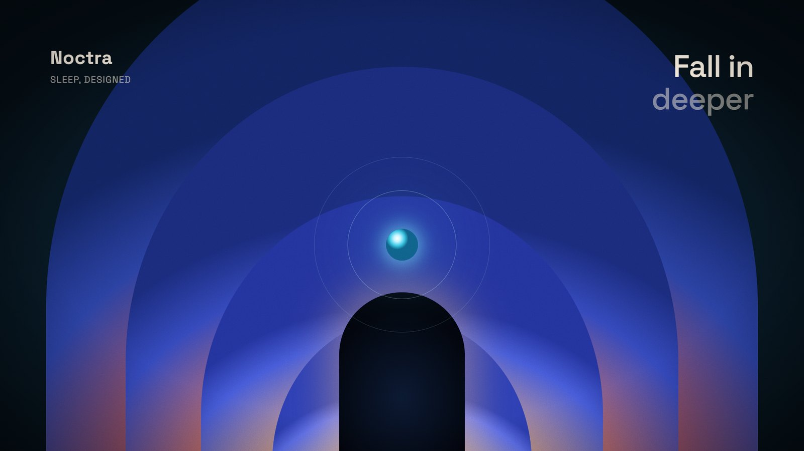

# Bang Motion Style Guide

High-end cinematic motion graphics for product demos, openers, kinetic typography, and explainers. Designed to defeat the "PPT/slides" trap:
1. **One continuous world:** Never static slides. The background breathes and drifts.
2. **Rich multi-layer background:** Dark deep base (#07090e) transitioning to a glowing horizon (#38bdf8 / #6366f1) + animated floating blobs + fine living film grain.
3. **Kinetic editorial typography:** Sentence case headlines with crisp contrast, drop shadows, and motivated focus highlights.
4. **Floating glass UI:** Translucent cards with frosted glass backdrop blur, hairline borders, and spotlight sweeps.
5. **Camera breathing:** Subtle continuous camera drift (scale 1.0 -> 1.05) on 1s with smooth ease curves.
