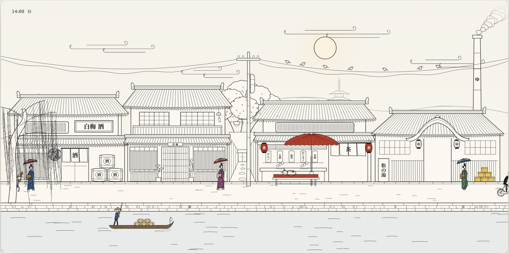

# Line Art Animation Style Guide

Hand-drawn Japanese and European ink line-art aesthetic. Crisp SVG path rendering, constant hairline pen weights (1.5–2.5px), animated gait solvers, architectural backgrounds, and atmospheric time-of-day palettes.
